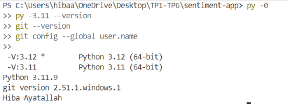
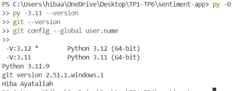
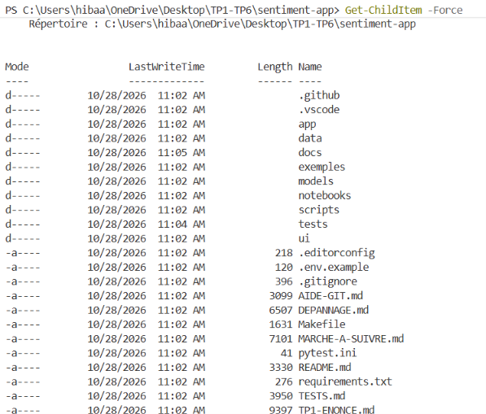
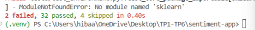
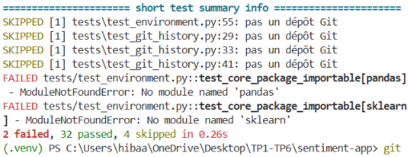
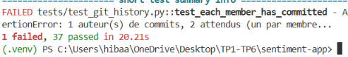
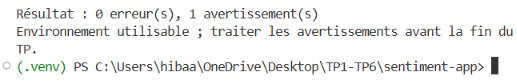
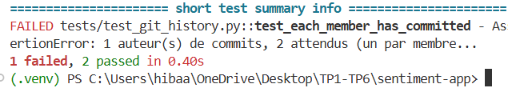
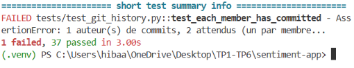

# Journal de projet — TP1 à TP6

## 1. Identification du projet

Projet : sentiment-app

Binôme :
- Membre A : Hiba Ayatallah
- Membre B : Hiba Ayatallah

Cours : Développement et déploiement d'applications intelligentes

## 2. Objectif général

Le projet consiste à concevoir, mettre en œuvre et valider une application de classification de sentiments à partir d'avis textuels. L'objectif est de cadrer le besoin métier, préparer l'environnement de travail, développer les composants fonctionnels du système et documenter l'ensemble des étapes de conception, implémentation et validation.

## 3. État du projet au terme du TP1

Le dépôt est validé pour le TP1, avec les éléments suivants :
- trois fiches de cadrage complètes et conformes aux exigences du cours ;
- environnement de travail configuré et fonctionnel ;
- historique Git valide avec deux auteurs distincts ;
- validation automatisée réussie : 38 tests passés.

Commande de validation exécutée :

```bash
.\.venv\Scripts\python.exe -m pytest -q
```

Résultat obtenu :

```text
38 passed in 3.44s
```

## 4. Convention de nommage des captures

Afin de garantir une traçabilité claire des étapes de développement, les captures sont nommées selon la convention suivante :

- `TP0-A.png`, `TP0-B.png` : captures préparatoires ou d'introduction
- `TP1-T0.png` à `TP1-T6.png` : contrôles et validations du TP1
- `TP2-C1.png`, `TP2-C2.png`, ... : captures de validation du TP2
- `TP3-C1.png`, `TP3-C2.png`, ... : captures de validation du TP3
- `TP4-C1.png`, `TP4-C2.png`, ... : captures de validation du TP4
- `TP5-C1.png`, `TP5-C2.png`, ... : captures de validation du TP5
- `TP6-C1.png`, `TP6-C2.png`, ... : captures de validation du TP6

Les captures sont enregistrées dans le dossier `docs/captures/`.

## 5. Déroulement du projet par TP

### TP1 — cadrage et préparation de l'environnement

Le TP1 a consisté à analyser le besoin métier, choisir une approche adaptée et préparer la base technique du projet. Les principales tâches réalisées sont les suivantes :
- lecture de la grille de décision et des éléments de cadrage ;
- remplissage des fiches de cadrage pour les trois cas proposés ;
- vérification de la présence des rubriques obligatoires et des critères de justification ;
- validation de la structure du dépôt ;
- vérification de l'environnement virtuel et des dépendances ;
- contrôle Git et validation du nombre d'auteurs de commits.

Les fichiers produits sont :
- `docs/cadrage/cas1-pharmacie.md`
- `docs/cadrage/cas2-reglement.md`
- `docs/cadrage/cas3-avis-negatifs.md`

Captures associées :



















### TP2 — entraînement du modèle de classification

Le TP2 a pour objectif d'entraîner un modèle capable de distinguer les avis positifs des avis négatifs à partir de textes. La méthode retenue repose sur une approche de traitement automatique du langage et un classifieur linéaire, en utilisant un pipeline comprenant vectorisation TF-IDF et régression logistique.

Les tâches principales sont :
- préparation des données textuelles ;
- séparation train/test avant toute transformation ;
- entraînement du modèle sur les avis ;
- évaluation de la précision et du rappel sur la classe négative ;
- sauvegarde du modèle dans `models/sentiment.joblib`.

Fichier de référence :
- `exemples/train_sentiment.py`

Commande :

```bash
python exemples/train_sentiment.py
```

Résultat attendu :
- score de rappel sur la classe négative supérieur au seuil requis ;
- modèle validé sur un jeu de test non vu pendant l'entraînement ;
- artefact sauvegardé pour utilisation ultérieure.

Captures prévues :
- `TP2-C1.png` : lancement et entraînement du modèle
- `TP2-C2.png` : rapport de classification
- `TP2-C3.png` : modèle enregistré

### TP3 — mise en œuvre de l'API de prédiction

Le TP3 a pour objectif de rendre le modèle exploitable par des clients externes via une interface applicative. L'API constitue le point d'entrée technique de la solution et permet la soumission de textes à analyser ainsi que l'obtention d'un résultat structuré.

Les tâches visées sont :
- chargement du modèle entraîné ;
- exposition d'un endpoint de prédiction ;
- validation des entrées et des sorties JSON ;
- vérification du bon fonctionnement du service.

Captures prévues :
- `TP3-C1.png` : démarrage de l'API
- `TP3-C2.png` : requête de prédiction
- `TP3-C3.png` : réponse JSON de validation

### TP4 — interface utilisateur

Le TP4 vise à faciliter l'utilisation du modèle par un utilisateur non développeur. Une interface de démonstration permet de tester directement le système sur des avis saisis manuellement ou sur un fichier CSV.

Les tâches principales concernent :
- création d'une interface utilisateur simple et lisible ;
- saisie d'un avis ;
- traitement de fichiers au format CSV ;
- affichage des résultats de prédiction et validation du flux utilisateur.

Commande :

```bash
streamlit run exemples/app_streamlit.py
```

Captures prévues :
- `TP4-C1.png` : lancement de l'interface
- `TP4-C2.png` : test sur un avis saisi
- `TP4-C3.png` : traitement d'un fichier CSV

### TP5 — validation fonctionnelle et intégration

Le TP5 consiste à vérifier la cohérence globale du système, depuis la collecte des données jusqu'à l'affichage du résultat final. Cette étape assure l'intégration des différents composants et confirme la robustesse de la solution.

Les éléments contrôlés sont :
- qualité des données et traitement du texte ;
- comportement du modèle sur différents cas ;
- gestion des erreurs et validation des entrées ;
- intégration entre API, modèle et interface utilisateur.

Captures prévues :
- `TP5-C1.png` : validation des tests
- `TP5-C2.png` : démonstration du flux complet
- `TP5-C3.png` : validation fonctionnelle finale

### TP6 — finalisation du projet

Le TP6 permet de clôturer le projet en consolidant la documentation et la présentation finale du système. L'objectif est de vérifier la cohérence du livrable, la qualité de la documentation et la capacité du dépôt à être exploité comme base de travail complète.

Les tâches concluent :
- mise à jour du journal ;
- vérification des fichiers de configuration et de documentation ;
- validation du dépôt dans son ensemble ;
- présentation de l'architecture et des résultats obtenus.

Captures prévues :
- `TP6-C1.png` : vue générale du projet
- `TP6-C2.png` : démonstration finale
- `TP6-C3.png` : validation de remise finale

## 6. Conclusion

Le projet sentiment-app est validé au terme du TP1, avec une base solide en matière de cadrage, d'environnement de travail et de validation. La suite du développement s'inscrit dans une logique progressive : cadrage du besoin, entraînement du modèle, exposition API, interface utilisateur, validation fonctionnelle et finalisation du livrable. Le journal de projet constitue ainsi une trace de suivi de la progression du projet de TP1 à TP6.
